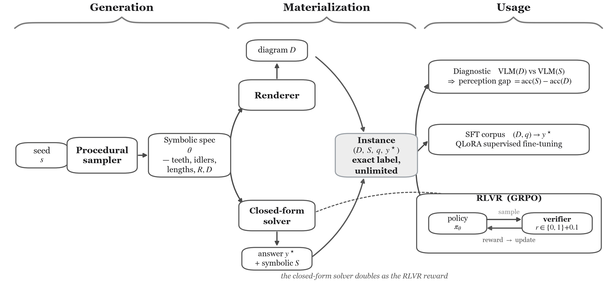

# MechaVerify

Code for the paper *A Verifiable Synthetic Environment for Grounded Mechanism and
Manufacturability Reasoning in Vision–Language Models*.



MechaVerify procedurally generates two-dimensional mechanism schematics with
closed-form ground truth. Every instance comes from a known symbolic specification,
so labels are exact and effectively unlimited. It covers two task families.

- Kinematics. Gear-train rotation sense and speed ratio, four-bar Grashof
  classification and rotatability, planar Kutzbach-Grübler mobility.
- Design for manufacturing. Internal-radius tool fit and depth-to-diameter
  machining traps.

Adversarial and counterfactual splits penalize shortcut heuristics. The environment
is used in three ways.

1. A diagnostic benchmark that separates perception from reasoning by pairing each
   diagram with a matched symbolic description.
2. A supervised fine-tuning corpus.
3. An RLVR environment in which the deterministic verifier is the GRPO reward.

## Install

```bash
git clone https://github.com/itswaseemsajjad/MechaVerify.git
cd MechaVerify
python -m venv .venv
source .venv/bin/activate        # Windows: .venv\Scripts\activate
pip install -r requirements.txt
pip install -e .                 # installs the mechaverify package and command
```

Run the commands below from the repository root. The generator, renderer and
verifier run on CPU. Evaluation and training dependencies are in
`requirements-eval.txt` and `requirements-train.txt`.

## Generate data

```bash
# list the seven tasks
python -m mechaverify.cli tasks

# render one instance and print its question, answer and rationale
python -m mechaverify.cli sample --task gear_sense --difficulty 3 --seed 1

# the released v0.1 set (825 instances from seeds 1,000,000 to 1,000,780)
python -m mechaverify.cli generate --out data/mv_release_v0_1 --n 60

# the same mechanisms in a hand-drawn style
python -m mechaverify.cli generate --out data/mv_release_v0_1_sketch --n 60 --sketch
```

Each dataset folder holds the images, `manifest.jsonl` and `dataset_card.json`. The
card records the seeds and generation parameters, so a dataset regenerates exactly
and the images do not need to be version-controlled. A correct regeneration of the
v0.1 set writes a `manifest.jsonl` with SHA-256
`5db2d657facb6df25d3146f5e79298e58402821a46e291a4efe0c9fde762442b`.

### Python API

```python
from mechaverify.rng import SeededRNG
from mechaverify.tasks import generate
from mechaverify.verify import check_answer, parse_response

gr = generate("gear_sense", SeededRNG(1), difficulty=3)
print(gr.question, "->", gr.answer.value)

response = "<think>three external meshes, so the output reverses the counterclockwise input</think><answer>clockwise</answer>"
correct, parsed, reason = check_answer(gr.answer, parse_response(response).answer_text)
print(correct, reason)
```

## Evaluate models

The harness scores a model under three input conditions. D is the diagram alone, S
is the gold symbolic description with no image, and D+S (written `DS`) is the diagram
together with the model's own generated description. The report goes to
`runs/eval.json` unless `--out` names another file. For each condition it gives
overall accuracy, accuracy per task, split and difficulty, and the format rate. When
both D and S run it also gives the perception gap, acc(S) minus acc(D).

```bash
pip install -r requirements-eval.txt
cp .env.example .env    # add GEMINI_API_KEY and/or OPENROUTER_API_KEY

# Gemini through its direct API
python -m mechaverify.cli evaluate --manifest data/mv_release_v0_1/manifest.jsonl \
    --provider gemini --model gemini-2.5-pro --split id_test --per-task 8 --conditions D,S \
    --out runs/gemini-2.5-pro_id_test.json

# any model on OpenRouter
python -m mechaverify.cli evaluate --manifest data/mv_release_v0_1/manifest.jsonl \
    --provider openrouter --model openai/gpt-5 --split id_test --per-task 8 --conditions D,S,DS \
    --out runs/gpt-5_id_test.json

# offline check without network or keys
python -m mechaverify.cli evaluate --manifest data/mv_release_v0_1/manifest.jsonl --provider dummy
```

`--split id_test --per-task 8` selects the fixed 56-item set, the first 8 items of
each task. The same works for `ood_test` and `adversarial`. Decoding is greedy with a
1536-token cap.

## Train with SFT and GRPO

The notebooks in `notebooks/` fine-tune Qwen2.5-VL-3B-Instruct on a single 16 GB
CUDA GPU. Open them with Jupyter (`pip install jupyterlab`, then `jupyter lab`). The
first cells install the training dependencies. Both notebooks regenerate the v0.1
set, train on its train split and score the result on the same 56 items per split
as the evaluation above.

- `sft_qlora.ipynb` trains a rank-16 QLoRA adapter for 200 steps on the solver
  rationales, with the vision encoder frozen. It then measures the perception gap of
  the base model and of the adapter.
- `grpo_rlvr.ipynb` runs 150 GRPO steps (G = 4, beta = 0.04) with binary correctness
  plus a 0.1 format bonus as the reward, continuing from the SFT adapter of the same
  seed. Set `SFT_ADAPTER = None` to start from the base model instead.

For each seed, run the SFT notebook before the GRPO notebook. Set `SEED` to 0, 1 and
2 for the three runs reported in the paper, all in the same clone. Results and
adapters are written to `runs/`, and the last cell of the GRPO notebook prints the
mean and standard deviation over seeds.

## Real drawings

An expert-labeled set of hand-drawn and textbook diagrams is planned. The tooling for
it is included, so the set runs through the same verifier and harness.
[docs/REAL_TEST_SET.md](docs/REAL_TEST_SET.md) shows how to build and evaluate it.

## Repository layout

```
mechaverify/
  specs.py      instance and answer data model
  rng.py        hermetic seeded RNG
  tasks/        gears, fourbar, mobility, dfma (samplers and closed-form solvers)
  render/       engineering-drawing renderers, including the hand-drawn style
  verify.py     response parser, answer checker and reward
  dataset.py    dataset generation, manifest and card
  eval/         evaluation harness (prompts, Gemini and OpenRouter providers, runner)
  train/        SFT and RL records, GRPO reward functions
  realset.py    real-drawing tooling
  cli.py        command-line interface
notebooks/      QLoRA SFT and GRPO notebooks
assets/         overview figure shown above
docs/           labeling guide for the real-drawing set
tests/          closed-form invariants, verifier, real-set tooling, training records
```

## Tests

```bash
python -m pytest
```

## License

MIT. See [LICENSE](LICENSE).
